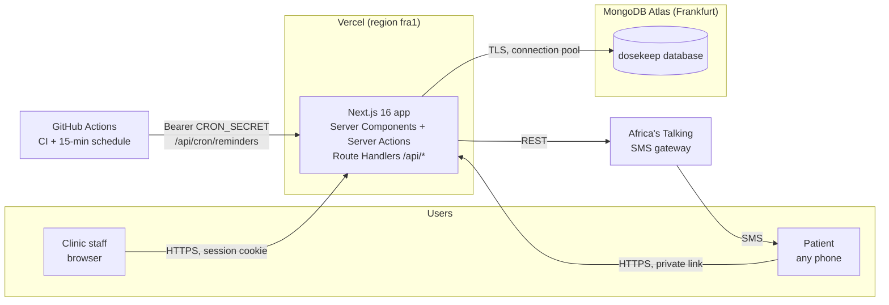
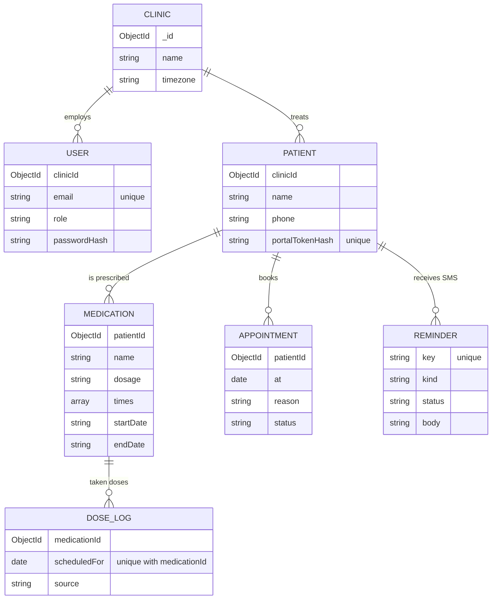
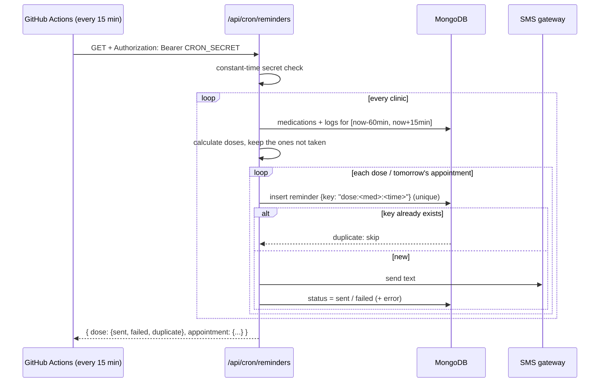
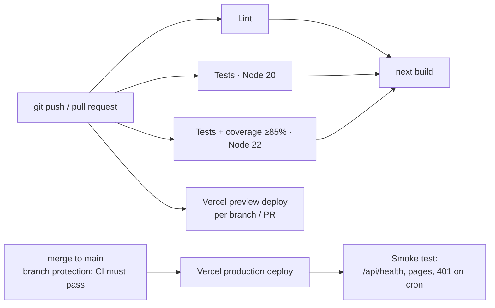

# DoseKeep: SMS medication reminders and adherence tracking for small clinics

**Project report** · Chimaroke Amadi · GoMyCode MSC capstone · November 2026

- **Live system:** _add your Vercel URL here after deploying_
- **Source code:** _add your GitHub URL here_

---

## 1. Introduction

A prescription only works if the patient takes it. For short courses, such as antibiotics, most people manage. For long-term conditions like hypertension, diabetes, HIV and tuberculosis, the treatment lasts months or a lifetime, and this is where it breaks down. Patients forget evening doses, run out between clinic visits, or stop when they feel better. The clinic usually finds out weeks later, at the next appointment, if the patient comes back at all.

DoseKeep is a web system for small clinics:

- It texts patients when a dose is due and the day before an appointment.
- It gives each patient a private link where they confirm doses with one tap.
- It shows clinic staff, on one dashboard, which patients are falling behind, so a nurse can call them while it still helps.

This report covers the research behind the problem, the architecture and technology choices, the implementation, testing and deployment, and an honest evaluation.

## 2. Problem and literature review

### 2.1 How big the problem is

The World Health Organization's report *Adherence to Long-Term Therapies* (WHO, 2003) estimated that only about 50% of patients with chronic diseases in developed countries take their medicines as prescribed. It also says the rate is likely lower in low- and middle-income countries. The report calls poor adherence "the primary reason for suboptimal clinical benefit". Osterberg and Blaschke (2005) reviewed the evidence in the *New England Journal of Medicine* and reached similar figures. They also describe the convention, used in most studies, of calling a patient "adherent" when they take at least 80% of prescribed doses. DoseKeep uses the same 80% threshold to flag patients at risk.

In Nigeria, the burden is growing fastest in conditions that need daily treatment for life. A systematic review by Adeloye et al. (2021) estimated the crude prevalence of hypertension in Nigerian adults at 30.6%. The same body of work reports low rates of awareness, treatment and control: many people who are diagnosed and prescribed medicine still don't have their blood pressure under control. HIV and tuberculosis programmes have the same structure: the drugs exist and are often free, but they only work with consistent daily use.

### 2.2 Why reminders, and why SMS

The causes of non-adherence are many: cost, side effects, beliefs about medicine, and access. No single tool fixes all of them. Nieuwlaat et al. (2014), in a Cochrane review, found that complex interventions tend to have modest effects. But **unintentional** non-adherence (simply forgetting) is one of the most common reasons patients give, and it is the cause that reminders address directly.

The evidence for text-message reminders is among the strongest in digital health:

- **Thakkar et al. (2016)**, in *JAMA Internal Medicine*, pooled 16 randomised trials with 2,742 patients with chronic diseases. Text messaging roughly doubled the odds of adherence (odds ratio 2.11). The authors translate this as moving from a 50% baseline to about 68%. The estimate shrinks to about 1.7 after adjusting for publication bias, and most trials used self-reported adherence over short periods, so the true effect is probably smaller. It is still consistently positive.
- **Pop-Eleches et al. (2011)** ran a randomised trial at a rural clinic in Kenya. 53% of HIV patients who received **weekly** SMS reminders reached at least 90% adherence, against 40% of the control group. Daily reminders showed no significant effect, which the authors attribute to people getting used to them.
- **Lester et al. (2010)**, the WelTel Kenya1 trial in *The Lancet*, showed that SMS follow-up from a clinician improved both adherence and viral suppression.

Two lessons shaped the design. First, reminders work, but a stream of identical messages loses its effect. So DoseKeep only texts about doses that are actually due and not yet confirmed, and a dose that was already marked as taken is never reminded. Second, the studies that worked best involved the **clinic** and not just the patient. That is why the dashboard matters as much as the SMS: it turns adherence data into a short call list for the nurse.

SMS was chosen over a mobile app or WhatsApp because it reaches every phone, including the basic and feature phones that many patients still use, and needs no mobile data or installation. The patient link is a plain web page, optimised for small screens, for those who do have a smartphone.

### 2.3 What exists already

Pill reminder apps depend on the patient installing them and give the clinic no view; hospital information systems are too expensive for small clinics. DoseKeep needs nothing from the patient but a phone number.

## 3. Requirements

**Users.**
- **Clinic admins** (a doctor or the clinic owner) register the clinic and manage the team.
- **Staff** (nurses, pharmacists) manage patients, medicines and appointments.
- **Patients** only receive SMS and use their private link.

**Functional requirements.**
1. A clinic can register, and its admin can add staff accounts.
2. Staff can add patients, prescribe medicines with times of day and a start/end date, stop a medicine, and book appointments.
3. Each patient receives a private link by SMS. On it they see today's doses and mark each one as taken, from 1 hour before to 3 hours after its time.
4. The system texts a reminder when a dose is due and not yet confirmed, and the day before an appointment. A reminder is never sent twice.
5. The dashboard shows:
   - the clinic's adherence over 14 days;
   - patients under 80% in the last 7 days, with their phone number;
   - doses due now;
   - upcoming appointments.
6. Each patient page shows a 30-day history, missed doses, and lets staff record a dose the patient reports by phone or in person.

**Non-functional requirements.**
- **Security and privacy:** health data must be isolated per clinic; passwords and patient links must survive a database leak.
- **Usability:** the staff app and the patient page must work on a phone; status is never shown by colour alone.
- **Reliability:** a late or failed reminder run must not lose or duplicate reminders.
- **Cost:** it should run on free tiers until a clinic pays for it.
- **Quality:** automated tests and CI on every change.

## 4. System architecture

### 4.1 Overview

The system is a single Next.js application deployed on Vercel, with MongoDB Atlas as the database and an SMS gateway for messages. It has three entry points:

- **Staff pages** (dashboard, patients, reminders, team) are React Server Components. They read from the database on the server and send ready HTML to the browser. Changes go through **Server Actions**, which are server functions that forms call directly.
- **The patient portal** (`/p/<token>`) is a server-rendered page. Its "I took it" button calls a small JSON API, `POST /api/portal/<token>/doses`.
- **The reminder job** (`GET /api/cron/reminders`) is protected by a shared secret. A GitHub Actions schedule calls it every 15 minutes, and Vercel Cron calls it once a day as a backup.

### 4.2 Code structure

The code is split into layers. Each layer only depends on the ones below it:

| Layer | Folder | Responsibility | Depends on Next.js? |
|---|---|---|---|
| Pages and UI | `src/app`, `src/components` | Rendering, forms, routing | yes |
| Web glue | `src/server` | Session cookie, login check, Server Actions | yes |
| Services | `src/services` | Use cases: register, add patient, log a dose, run reminders, dashboard | no |
| Domain logic | `src/lib` | Time zones, dose schedule, adherence maths, validation, tokens, SMS client | no |

The services take the database as their first argument (`logDose(db, {...})`) instead of importing a global connection, so the business logic is testable without Next.js and reusable behind another interface, such as USSD.

### 4.3 Technology choices

| Choice | Alternatives considered | Why |
|---|---|---|
| **Next.js 16** (React 19), JavaScript | Express API + React SPA; Django | One codebase and one deployment for UI and API. Server Components keep patient data on the server and ship little JavaScript, which matters on slow mobile networks. Server Actions remove a whole layer of hand-written API endpoints for staff forms. |
| **MongoDB Atlas** | PostgreSQL (e.g. Neon, Supabase) | The data is document-shaped (a medication with an array of times; a patient with optional fields). The access patterns are all "by clinic, by patient, by date range", which compound indexes serve directly; Atlas adds a free tier and a Frankfurt region next to the functions. PostgreSQL would have worked equally well. |
| **Vercel** | Render, Azure App Service | Built for Next.js: zero-config builds, a preview deployment for every pull request, HTTPS and a CDN included, free for this scale. Its limitation (cron only once a day on the free plan) is solved with GitHub Actions; see 8.2. |
| **Africa's Talking** for SMS | Twilio | Direct routes to Nigerian networks, local sender IDs and lower prices in Africa; it has a free sandbox for testing. The SMS layer is one small module behind an interface, so switching provider is a one-file change. |
| **jose** (JWT), **bcryptjs**, **zod** | NextAuth/Auth.js; Joi | A signed session cookie is all a staff login needs; a full auth framework would add more than it saves. bcrypt is the standard for password hashing. zod validates every form on the server and produces readable per-field messages. |
| **node:test** + **mongodb-memory-server** | Jest, Vitest | Built into Node, so nothing extra to install or configure. The in-memory server is a real MongoDB 8, so the tests check real queries and indexes, not mocks. |

## 5. Data design

### 5.1 Collections

Every document except the clinic carries a `clinicId`. Every query the application makes filters on the `clinicId` taken from the signed session, never from the URL. This is how the system stays **multi-tenant**: a staff member who changes a patient id in the address bar gets "not found", not another clinic's patient. A test checks exactly this.

### 5.2 The key decision: calculate the schedule, store only what happened

The obvious design is to create one document per scheduled dose: a patient on two medicines, twice a day, for a year, would be about 1,460 documents created in advance. I chose not to. A medication stores its rule: times `["08:00", "20:00"]` from `startDate` to an optional `endDate`. The schedule for any date range is **calculated** from that rule, and only doses that were actually **taken** are stored, in `doseLogs`. A dose with no log becomes "missed" once its window closes.

This has three advantages:
- changing or stopping a prescription needs no clean-up of future rows;
- storage grows with real events, not with time;
- "missed" can never be out of date, because it is derived rather than written by a background job.

The cost is calculation on every read, which is cheap for a small clinic (see 10).

Times are prescribed in the clinic's local time zone and stored as UTC instants. "08:00 in Lagos" is converted with the browser-standard `Intl` API, without a date library. The tests include a daylight-saving change in London, to prove the conversion is correct for clinics outside West Africa too.

### 5.3 Indexes and integrity

| Index | Purpose |
|---|---|
| `users.email` unique | one account per email |
| `patients.portalTokenHash` unique | look up a patient from their link |
| `doseLogs {medicationId, scheduledFor}` unique | a dose can only be logged once: double taps and retries are harmless |
| `reminders.key` unique | a reminder can only be sent once (see 6.3) |
| `doseLogs {clinicId, scheduledFor}`, `appointments {clinicId, at}`, `medications {clinicId, patientId}` | the dashboard's range queries |
| `loginAttempts.at` TTL (1 hour) | failed logins expire automatically |

## 6. Implementation

### 6.1 Main flows

**Logging a dose from the patient's phone.**
1. The portal page finds the patient by hashing the token in the URL.
2. It calculates today's doses and shows "I took it" next to each dose that is due.
3. Tapping it sends `{ medicationId, at }` to the API.
4. The service checks that the medication belongs to this patient, that `at` is a real scheduled time for it, and that the dose is inside its window.
5. It then performs an **upsert** keyed on the unique index, so two taps produce one log.

**Sending reminders.**

### 6.2 Security

- **Passwords:** hashed with bcrypt (cost 12). Login errors don't reveal whether the email exists. When the email is unknown, the code still compares against a dummy hash, so both cases take the same time.
- **Brute force:** after 5 failed attempts in 15 minutes the account is locked for that window. Failures are stored with a TTL index, so they clean themselves up.
- **Sessions:** an HS256-signed JWT in an `HttpOnly`, `Secure`, `SameSite=Lax` cookie that lasts one 8-hour shift. Every staff page and every Server Action re-checks the session **and** reloads the user from the database, so a removed account loses access immediately. Next.js Server Actions also reject cross-origin requests, which protects forms against CSRF.
- **Patient links:** 24 random bytes (192 bits) encoded in the URL. Only a SHA-256 hash is stored, and the SMS text saved in the database replaces the link with `[private link]`. A database leak therefore exposes no working links. Staff can replace a link at any time, and the old one stops working.
- **Authorisation:** only admins can add team members or run reminders by hand. Every query is scoped by clinic.
- **Input validation:** zod schemas on the server for every form. Phone numbers are normalised to international format (`0803…` becomes `+234803…`), and dates are checked to be real (no 30 February).
- **HTTP headers:** a Content-Security-Policy, `X-Frame-Options: DENY`, HSTS, and `Referrer-Policy: no-referrer`, so the token in a patient's URL is never sent to another site.
- **Secrets:** only in environment variables (Vercel and GitHub encrypted secrets), never in the repository. The cron secret is compared in constant time.

Patient data is health data, which the Nigeria Data Protection Act 2023 treats as sensitive. DoseKeep collects the minimum (name, phone, condition, medicines). A real launch would need a data processing agreement with each clinic and patient consent for SMS; I list this in section 10.

### 6.3 Reliability

Reminders have to be both **at-least-once** (a late or skipped run must not lose a reminder) and **at-most-once** (a patient must never get the same text twice). Every run looks back one hour and ahead 15 minutes, so the 15-minute schedule overlaps itself and a late run still catches the dose. Duplicates are then prevented by the database rather than by the code: each message has a deterministic key such as `dose:<medicationId>:<time>`, with a unique index. The first run to insert the key sends the SMS; any other run gets a duplicate-key error and skips it. The message is recorded as `pending` **before** sending and updated to `sent` or `failed` with the error. If the provider is down, the failure is visible on the Reminders page instead of being silent.

The database connection is created once per server instance and reused across requests, and a failed connection is retried on the next request. `/api/health` pings the database for monitoring.

### 6.4 Usability and accessibility

- **Patient page:** mobile-first, with large buttons (52 px), plain language ("I took it"), and no login or app to install.
- **Staff app:** works at 390 px wide without horizontal scrolling. I checked this with automated screenshots in headless Chrome.
- **Status:** always shown as icon + word (✓ Taken, ✕ Missed, ● Due now), never by colour alone. At-risk rates also carry a ⚠ and screen-reader text.
- **Chart:**
  - one series with a dashed 80% target line;
  - a hover/keyboard tooltip with exact numbers;
  - a "Show as a table" alternative;
  - it is drawn at its real pixel width so its text stays readable on phones.
- **Forms:** each error is shown next to its field, and the values typed are kept after an error.

## 7. Testing and quality

The project has **25 automated tests**:
- **Unit tests** for the pure logic: time-zone conversion (including daylight saving), dose schedules, dose windows, adherence maths, validation, phone normalisation, session tokens and the SMS client. The SMS client is tested with a fake `fetch`.
- **Integration tests** for every service, against a real in-memory MongoDB 8: login lockout, admin-only actions, isolation between clinics, portal link reset and hashing, dose windows and idempotent logging, duplicate medicines, at-risk detection, reminders sent exactly once, and failed SMS recorded with the error.

The tests cover **94.7% of the lines** of the logic layers (`src/lib` and `src/services`). The pages were tested end to end with a headless-Chrome script: wrong and right logins, invalid and valid forms, running reminders, the patient portal at phone size, and a broken link, with no console errors allowed. It caught two real problems before release: chart text unreadable on phones, and the same medicine could be added twice, doubling reminders.

ESLint runs with Next.js's recommended rules plus `eqeqeq`, `no-var` and `prefer-const`, and reports 0 problems.

## 8. CI/CD and deployment

### 8.1 Pipeline

GitHub Actions (`.github/workflows/ci.yml`) runs lint and tests on Node 20 and 22 in parallel, then a production build. On Node 22 the coverage must stay above 85%. Vercel's GitHub integration deploys a **preview URL for every pull request**, so a change can be clicked through before merging, and **production on every merge to `main`**. Branch protection on `main` requires the CI jobs to pass. After each production deployment, `smoke.yml` checks four things:
- the health endpoint, including the database;
- the home page;
- the login page;
- that the cron endpoint refuses requests without the secret.

### 8.2 Cloud setup

- **Vercel**, region `fra1` (Frankfurt). Serverless functions scale to zero, and HTTPS and the CDN are automatic.
- **MongoDB Atlas** free M0 cluster in AWS Frankfurt (`eu-central-1`), the same region as the functions. Each database round trip stays within one region (a few milliseconds), which matters because a dashboard makes several. Access is restricted to a dedicated database user with read/write rights on one database.
- **Scheduling:** Vercel's free plan only allows cron jobs once a day, which is too slow for dose reminders. Instead, `.github/workflows/reminders.yml` calls the reminder endpoint every 15 minutes with the secret. `vercel.json` keeps one daily Vercel Cron as a backup, and because reminders are idempotent, the two never conflict. GitHub's scheduler can start runs several minutes late; the one-hour look-back absorbs that. On a paid plan, the GitHub schedule could be replaced by Vercel Cron every 15 minutes, with no code change.
- **Configuration:** all settings are environment variables documented in `.env.example`: database URI, session and cron secrets, app URL and SMS provider. With `SMS_PROVIDER=log` (the default), messages are recorded and visible on the Reminders page but not sent, which is useful for demos. With `africastalking`, they are sent for real.

The deployment guide is in [DEPLOY.md](DEPLOY.md).

## 9. Results

- **Implemented:** every functional requirement in section 3.
- **Demo data:** a seed script creates a demo clinic with 8 patients and 5 weeks of realistic history (different adherence levels, worse at weekends), so the dashboard shows real patterns: in the sample data, 3 of 8 patients are flagged at risk.
- **Tests:** 25 tests pass, coverage of the logic is 94.7%, and lint reports 0 problems.

The most important result is the design itself:
- adherence is **derived** from the schedule and the dose logs instead of being maintained by background jobs;
- reminder delivery is made safe by **database constraints** instead of careful timing.

These two decisions removed whole classes of bugs (stale "missed" flags, duplicate texts) rather than testing for them.

## 10. Limitations and future work

- **Scale.** The dashboard calculates two weeks of schedule for the whole clinic on each load. That is fast for hundreds of patients but would not be for tens of thousands. The next step would be a nightly `$merge` aggregation that stores daily adherence per patient, with the live calculation used only for today.
- **Two-way SMS.** Patients without smartphones can't open the link. Africa's Talking supports inbound SMS and USSD, so replying "1" to confirm a dose is a natural next feature. The service layer is ready for it, since `logDose` doesn't care where the request comes from.
- **Measurement.** Self-reported "I took it" can't prove ingestion; this is the same limitation as most of the trials in section 2. Pharmacy refill data would be a useful second signal.
- **Reminder fatigue.** Pop-Eleches et al. found weekly reminders worked better than daily ones. A clinic should be able to choose the frequency per patient (every dose, daily summary, or only after a missed dose). Today every due dose is reminded.
- **Compliance.** Before real patient data: consent capture, a data processing agreement, an audit log of who viewed what, and encryption of the most sensitive fields.
- **Operations.** Error monitoring and alerts on failed SMS.

## 11. Conclusion

DoseKeep addresses a well-documented, expensive problem with an intervention that has solid evidence behind it, and packages it in a form a small clinic can adopt in minutes. The project taught me most where real-world constraints pushed back: time zones, free-tier cron limits, and the difference between sending "at least once" and "exactly once". The result is a deployed, tested, secure system that I would be comfortable putting in front of a real clinic for a pilot, with a clear list of what must come next.

## References

- Adeloye, D. et al. (2021). Prevalence, awareness, treatment, and control of hypertension in Nigeria in 1995 and 2020: a systematic analysis of current evidence. *Journal of Clinical Hypertension*, 23(5), 963–977.
- Lester, R. T. et al. (2010). Effects of a mobile phone short message service on antiretroviral treatment adherence in Kenya (WelTel Kenya1): a randomised trial. *The Lancet*, 376(9755), 1838–1845.
- Nieuwlaat, R. et al. (2014). Interventions for enhancing medication adherence. *Cochrane Database of Systematic Reviews*, (11), CD000011.
- Osterberg, L. & Blaschke, T. (2005). Adherence to medication. *New England Journal of Medicine*, 353(5), 487–497.
- Pop-Eleches, C. et al. (2011). Mobile phone technologies improve adherence to antiretroviral treatment in a resource-limited setting: a randomized controlled trial of text message reminders. *AIDS*, 25(6), 825–834.
- Thakkar, J. et al. (2016). Mobile telephone text messaging for medication adherence in chronic disease: a meta-analysis. *JAMA Internal Medicine*, 176(3), 340–349.
- World Health Organization (2003). *Adherence to Long-Term Therapies: Evidence for Action*. Geneva: WHO.
- Nigeria Data Protection Act, 2023.
- Vercel documentation: Cron Jobs, usage and pricing (Hobby plan: once per day).
